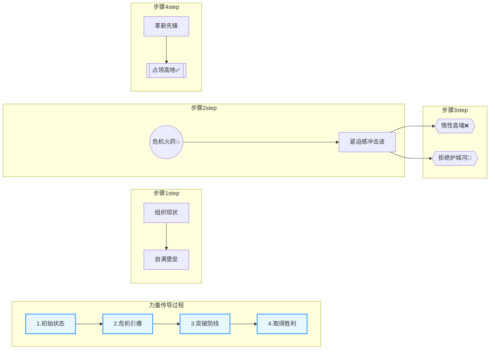

### 方案三：伪动画时间轴（单图显示全流程）


### Obsidian 专用优化技巧：
1. **分步显示**：创建多个笔记，每页显示一个步骤，使用`[[下一步]]`链接
2. **Callout提示**：添加说明文本
   ```markdown
   > [!NOTE] 操作指南
   > 1. 当前显示：**危机引爆阶段**
   > 2. 切换下一步：[[变革力量传导-步骤3]]
   ```
3. **使用图标增强表现**：
   ```mermaid
   graph LR
       E((("💣 危机火药"))) -->|引爆| F[["🌊 紧迫感冲击波"]]
       F --> B{{"🧱 惰性高墙 ❌"}}
   ```

4. **颜色编码流程**：
   ```mermaid
   graph LR
       A[自满状态]:::red -->|被| B[危机意识]:::orange
       B --> C[紧迫感]:::yellow
       C --> D[变革行动]:::green
       
       classDef red fill:#ffcccc
       classDef orange fill:#ffd8a6
       classDef yellow fill:#ffffcc
       classDef green fill:#ccffcc
   ```
